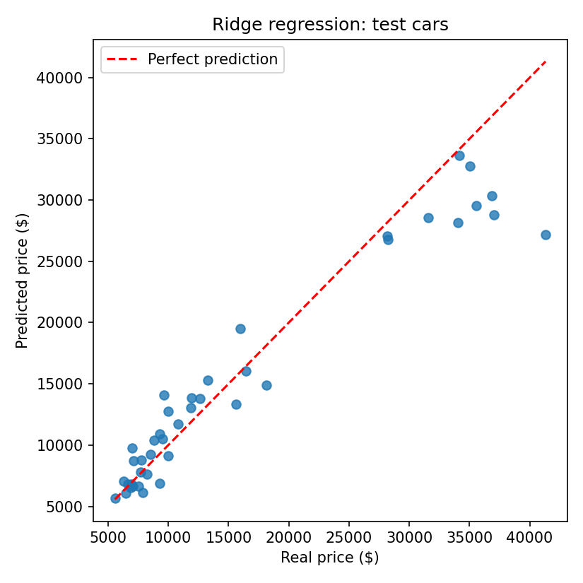

# Task 2: Predictive Linear Regression Pipeline

Predict the price of a car with a regularized Ridge regression model.

**Result:** R² = 0.9253 and RMSE = $3,023.52 for Ridge (alpha = 1.0) on 41 test cars.

## Data
UCI Automobile (imports-85) dataset: 205 cars, 25 features (15 numeric, 10 categorical) and the target `price`. Some values are missing (`?` in the file). 4 cars have no price and are removed, which leaves 201 cars. The notebook loads it with scikit-learn (`fetch_openml`). If that fails, it reads the same file from the UCI repository.

## Method
- 80/20 train/test split (160 and 41 cars, `random_state=42`).
- Preprocessing inside one scikit-learn `Pipeline`, learned on the training data only:
  - numeric columns: mean imputation, then `StandardScaler`
  - categorical columns: most-frequent imputation, then `OneHotEncoder`
- Model: `Ridge(alpha=1.0)`, then plain `LinearRegression` for comparison, then alpha tuned with `GridSearchCV` (5-fold cross-validation on the training data only).
- Metrics logged: R² and RMSE.

## Results (41 test cars)
| Model | R² | RMSE ($) |
|---|---|---|
| Ridge (alpha=1.0) | 0.9253 | 3,023.52 |
| Linear Regression | 0.9131 | 3,261.16 |
| Ridge tuned (alpha=3) | 0.9012 | 3,476.26 |

Cross-validation RMSE on the training cars for each alpha:

| alpha | 0.01 | 0.1 | 1 | 3 | 10 | 30 | 100 |
|---|---|---|---|---|---|---|---|
| CV RMSE ($) | 2,630 | 2,577 | 2,546 | 2,536 | 2,582 | 2,723 | 3,005 |

Alpha = 3 has the lowest cross-validation error, so it is the final tuned model. It scored a little lower than alpha = 1 on the test cars. I did not change alpha after seeing the test score, because the test cars must not be used to choose settings.

## What I learned
- Ridge (alpha = 1.0) is a bit better than plain Linear Regression, but the three models are close.
- The model is good for cheap and medium cars. It predicts too low for the most expensive cars (above about $28,000).
- With only 41 test cars, small differences between models are not reliable.

## Limitations
Only 201 cars, one train/test split, and the prices are from 1985. Next step: predict the log of the price or try a non-linear model.

## Files
- `Task2_Ridge_Regression.ipynb`: the notebook with outputs
- `task2_results.csv`: results table from the notebook
- `predicted_vs_real.png`: chart from the notebook
