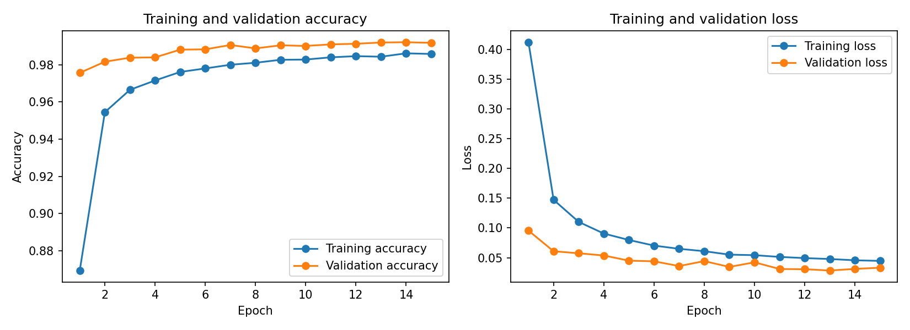
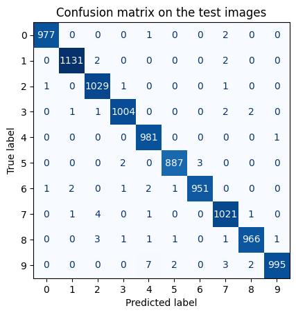

# Task 3: Multi-Class Image Classification with a CNN

Classify handwritten digits (0 to 9) from the MNIST dataset with a convolutional neural network built in TensorFlow / Keras.

**Result:** 99.42% accuracy on the 10,000 test images (58 wrong predictions).

## Data
MNIST: 60,000 training images and 10,000 test images (28 x 28 grayscale). 10% of the training images (6,000) are kept as a validation set, so the test images are used only once at the end.

## Model
`Input (28x28x1)`, data augmentation (random rotation, zoom and shift), `Conv2D(32)`, `MaxPooling`, `Conv2D(64)`, `MaxPooling`, `Flatten`, `Dropout(0.3)`, `Dense(128)`, `Dense(10, softmax)`. 225,034 trainable parameters.

- Overfitting is reduced with data augmentation, dropout and early stopping (patience 3, up to 15 epochs).
- Optimizer: Adam. Loss: sparse categorical cross-entropy. Batch size: 64.

## Results
| Metric | Value |
|---|---|
| Test accuracy (10,000 images) | 99.42% |
| Test loss | 0.0210 |
| Wrong predictions | 58 |
| Final validation accuracy | 99.18% |
| Final training accuracy | 98.59% |
| Epochs trained | 15 (early stopping did not trigger) |

Training and validation accuracy stay close together, so there is no sign of overfitting. Training accuracy is a little lower because augmentation and dropout make the training images harder.

### Mistakes

Every digit has precision and recall above 98.6%. Digit 9 has the most mistakes (14 images). The most common confusion is a real 9 predicted as 4 (7 times).

## Limitations
MNIST is a clean and easy dataset, so a high accuracy does not show that the model works on messy real-world images. Results come from one training run, so the last decimals can change a little between runs.

## Files
- `Task3_CNN_MNIST.ipynb`: the notebook with outputs
- `training_curves.png`: accuracy and loss curves
- `confusion_matrix.png`: confusion matrix on the test images
